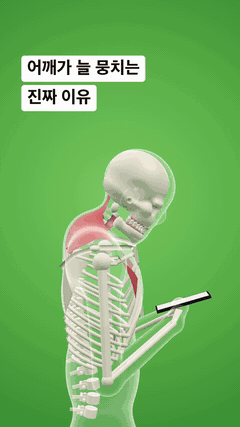
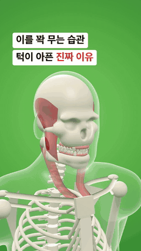
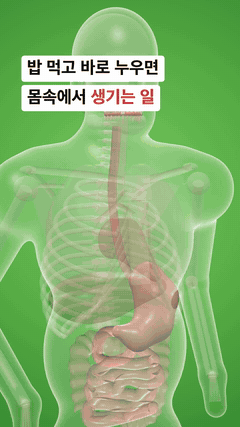
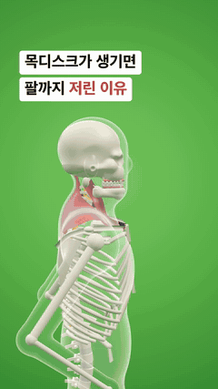

# anatomy-motion

**유리 인체 3D 해부학 숏폼을 코드로 만드는 Claude Code 스킬** — 정형외과·치과·내과 환자 교육 영상, 통증 원인 설명 쇼츠/릴스/틱톡.

투명한 유리 몸 안에 뼈·근육·장기·치아·디스크·신경을 실제 3D로 그리고, 통증 유발점, 연관통 경로, 여러 각도의 카메라, 미시 클로즈업, 한글 자막과 (선택) ElevenLabs 나레이션까지 한 번에 만듭니다. 유료 AI 영상 생성 크레딧은 쓰지 않습니다. 화면은 전부 코드([HyperFrames](https://hyperframes.heygen.com) + [three.js](https://threejs.org))로 렌더링됩니다.

| 정형외과: 승모근 통증 | 치과: 이갈이·턱관절 | 내과: 역류성 식도염 | 시작 템플릿: 목디스크 |
| --- | --- | --- | --- |
|  |  |  |  |

## 무엇을 보여줄 수 있나

- **정형외과 · 재활 · 한의원**: 고개 숙임·돌림·턱 당기기·라운드숄더·어깨 으쓱 자세, 폰을 든 팔·목 주무르기·머리 넘겨 스트레칭 같은 팔 동작(손가락 포함), 승모근·견갑거근(늘어남 화살표)·소흉근·흉쇄유돌근, 경추 디스크와 척수·신경근, 디스크 탈출로 눌린 신경, 통증 유발점과 연관통, 고개 각도별 목 하중(Hansraj 2014)
- **치과**: 열리고 닫히는 아래턱, 치아 32개(치관·치근), 잇몸, 교근(악물 때 부풂)·측두근, 턱관절, 치아 단면(마모·균열·상아질 노출·시림)
- **내과 · 소화기**: 폐·심장·대동맥·기관지·식도·위·간·담낭·비장·신장·십이지장·소장·대장, 음식물 이동, 위산 역류, 눕기·기울이기, 장기 염증 표시, 하부식도괄약근 단면
- **공통**: 유리 피부 위 통증 발광, 지시선 라벨, 근육 표면을 따라 들어가는 카메라 다이브, 뼈·장기·근육 투명도 조절, TikTok 흰 박스 자막

## 설치

```bash
git clone https://github.com/passeth/anatomy-motion ~/.claude/skills/anatomy-motion
```

Codex 등 다른 에이전트는 각자의 skills 폴더(예: `~/.agents/skills/anatomy-motion`)에 같은 방법으로 받으면 됩니다.

필요한 것: Node.js 22+, FFmpeg, WebGL이 되는 Chrome(HyperFrames가 자동으로 사용), Python 3.9+. 나레이션은 선택 사항이고 ElevenLabs API 키가 필요합니다. 효과음은 HyperFrames의 media-use 스킬이 설치돼 있으면 자동으로 복사합니다(Pixabay 라이선스라 이 저장소에는 넣지 않았습니다).

## 사용법

Claude Code에서 그냥 말하면 됩니다.

> 거북목 때문에 두통이 생기는 이유를 설명하는 30초 해부학 숏폼 만들어줘

직접 실행하려면:

```bash
python3 ~/.claude/skills/anatomy-motion/scripts/new_project.py ortho-trapezius ./my-film   # dental-bruxism, internal-reflux, blank
cd my-film && npx hyperframes preview --background                                         # Studio 미리보기
ELEVENLABS_API_KEY=... python3 ~/.claude/skills/anatomy-motion/scripts/tts_elevenlabs.py . --voice "목소리 이름"
python3 ~/.claude/skills/anatomy-motion/scripts/words.py .                                 # 단어별 시각 -> 장면 키 맞추기
npx hyperframes render --quality delivery --output renders/my-film.mp4
```

장면은 `compositions/stage.html`의 `story` 객체 하나로 기술합니다(포즈·근육 열감·통증점·경로·카메라·라벨 트랙). 필드 전체는 [references/engine-api.md](references/engine-api.md)에, 진료과별 구성법은 [references/story-recipes.md](references/story-recipes.md)에, 근육·장기 추가법은 [references/extending.md](references/extending.md)에 있습니다.

## 의학 정보에 대해

이 스킬이 만드는 영상은 교육용이며 진단이나 치료를 대신하지 않습니다. 예제의 수치와 설명은 출처를 [references/medical-accuracy.md](references/medical-accuracy.md)에 적어 두었습니다. 게시 전에 전문가 검토를 권합니다. 의료기관이 광고 목적으로 쓸 때는 의료법(제56조)과 의료광고 심의 대상 여부를 확인하세요.

---

## English

**A Claude Code skill that turns code into glass-body 3D anatomy shorts** for orthopaedics, dentistry and internal medicine: bones, muscles, organs, teeth, discs and nerves inside a transparent body, with trigger points, referred-pain paths, multi-angle camera moves, micro close-ups, Korean captions and optional ElevenLabs narration. No paid AI-video generation; everything renders deterministically with HyperFrames and three.js.

- Install: `git clone https://github.com/passeth/anatomy-motion ~/.claude/skills/anatomy-motion`
- Requirements: Node.js 22+, FFmpeg, Chrome with WebGL, Python 3.9+; optional ElevenLabs key for narration.
- Start: `python3 scripts/new_project.py <ortho-trapezius|dental-bruxism|internal-reflux|blank> ./my-film`, then edit the `story` in `compositions/stage.html` (see `references/engine-api.md`).
- Coordinates are centimetres, y up, the person faces +z, +x is the person's left. Every frame is a pure function of time.

Educational content only, not medical advice. Check the sources in `references/medical-accuracy.md` and have a professional review before publishing.

## License

MIT © 2026 passeth. three.js (MIT) and GSAP are loaded from CDNs at render time. Sound effects are not included.
